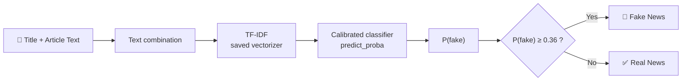

<div align="center">

# 🛡️ TruthLens AI
### AI-Powered Misinformation Detection System

**An end-to-end NLP system that classifies English news articles as _Real_ or _Fake_ — with calibrated probabilities, a frozen production threshold, and a modern Streamlit interface.**

[](https://ai-powered-misinformation-detection-system-kpwevip8yqegvhzvnrk.streamlit.app/)
[](https://www.python.org/)
[](https://scikit-learn.org/)
[](#-production-design)

[**🚀 Live Demo**](https://ai-powered-misinformation-detection-system-kpwevip8yqegvhzvnrk.streamlit.app/) ·
[**📦 Repository**](https://github.com/AbdelrhmanAkl/AI-Powered-Misinformation-Detection-System) ·
[**⚠️ Limitations**](#-limitations) ·
[**🛡️ Responsible Use**](#-responsible-use)

</div>

---

> [!IMPORTANT]
> TruthLens AI is a **machine-learning text classifier, not a fact-checking engine**. It recognizes language patterns associated with the labels in its training data. It does **not** verify claims or determine objective truth.

---

## 📑 Table of Contents

- [Overview](#-overview)
- [Highlights](#-highlights)
- [Application](#-application)
- [How It Works](#-how-it-works)
- [Production Design](#-production-design)
- [Dataset](#-dataset)
- [Evaluation](#-evaluation)
- [Getting Started](#-getting-started)
- [Batch Analysis (CSV)](#-batch-analysis-csv)
- [Project Structure](#-project-structure)
- [Tech Stack](#-tech-stack)
- [Limitations](#-limitations)
- [Responsible Use](#-responsible-use)
- [Roadmap](#-roadmap)
- [Author](#-author)

---

## 🔎 Overview

TruthLens AI takes a **news headline** and **article body**, runs them through a saved production pipeline, and returns:

- a **verdict** — Real News or Fake News
- **probabilities** for both classes
- the **decision threshold** applied to the fake-news score

The model is trained offline and shipped as **one frozen artifact**. The app only performs inference: nothing is retrained or re-fitted when users submit articles.

| | |
|---|---|
| **Task** | Binary text classification (English news) |
| **Input features** | `title` + `text` |
| **Excluded features** | `subject`, `date` |
| **Vectorizer** | TF-IDF (`TfidfVectorizer`) |
| **Classifier** | `CalibratedClassifierCV` (probability-calibrated linear model) |
| **Decision rule** | Fake if `P(fake) ≥ 0.36` |
| **Labels** | `0` = Real News · `1` = Fake News |

---

## ✨ Highlights

- 🎯 **Calibrated probabilities** — verdicts come with real/fake scores, not just a hard label.
- 🔒 **Frozen inference** — only `vectorizer.transform()` is used; no `fit` / `fit_transform` at runtime.
- 🎚️ **Stored threshold** — the production threshold (`0.36`) lives inside the model package and is reused consistently.
- 📦 **Single production artifact** — model, vectorizer, threshold, feature policy, label mapping and metadata travel together.
- 📂 **Batch mode** — upload a CSV and download predictions for every row.
- 🧪 **Honest evaluation** — diagnostics are labeled as diagnostics, not as held-out generalization.
- 🎨 **Modern UI** — dark glassmorphism design, one-click examples, confidence ring and threshold-aware score meter.

---

## 🖥️ Application

The Streamlit app has three tabs:

| Tab | What it does |
|---|---|
| **🔍 Analyze** | Paste a headline and article body (or load a built-in real/fake example) and get a verdict, confidence ring, probability breakdown and a score meter showing where the article sits relative to the threshold. |
| **📂 Batch** | Upload a CSV with `title` and/or `text` columns, run inference on every row, filter results and download a predictions CSV. |
| **🧠 Model** | Inspect the pipeline, saved configuration, feature policy and package metadata. |

<!-- Add screenshots here -->
<!--
<p align="center">
  
</p>
-->

---

## ⚙️ How It Works



1. **Combine** — headline and body are merged into one document.
2. **Vectorize** — the saved TF-IDF vectorizer converts text into weighted numeric features.
3. **Score** — the calibrated classifier outputs probabilities for both classes.
4. **Decide** — the saved threshold turns the fake-news probability into the final label.

---

## 🏭 Production Design

The production model is stored as a single Joblib package:

```text
models/misinformation_model_package.joblib
```

```text
model            trained, calibrated classifier
vectorizer       fitted TF-IDF vectorizer
threshold        frozen decision threshold (0.36)
config           training configuration
seed             random seed
model_name       human-readable model name
feature_policy   which fields are used for inference
label_mapping    class index → label
metadata         additional package information
```

On load, the app **validates** the package (required keys, `predict_proba` / `transform` support, threshold range, feature policy) and fails with a clear message if anything is wrong.

### Feature policy

| Feature | Used in production |
|---|:---:|
| `title` | ✅ |
| `text` | ✅ |
| `subject` | ❌ |
| `date` | ❌ |

---

## 📚 Dataset

Two labeled English news datasets:

```text
data/True.csv      →  21,417 articles  (Real)
data/Fake.csv      →  23,481 articles  (Fake)
                      ───────────────
                      44,898 articles total
```

| Column | Description | Used for inference |
|---|---|:---:|
| `title` | Article headline | ✅ |
| `text` | Article body | ✅ |
| `subject` | Dataset subject category | ❌ |
| `date` | Publication date | ❌ |

---

## 📈 Evaluation

### Production Inference Diagnostic

A diagnostic was run on **1,000 samples** (500 real + 500 fake) drawn from `True.csv` and `Fake.csv`.

| Metric | Result |
|---|---:|
| Accuracy | **99.90%** |
| Precision | **100.00%** |
| Recall | **99.80%** |
| F1 Score | **99.90%** |

**Confusion matrix**

|  | Predicted Real | Predicted Fake |
|---|---:|---:|
| **Actual Real** | 500 | 0 |
| **Actual Fake** | 1 | 499 |

> [!WARNING]
> These numbers are a **production inference diagnostic**, **not** an independent held-out test result. The samples come from the same source datasets the model was developed on, so they must **not** be read as an estimate of real-world generalization. Reliable generalization claims require an independent held-out set, external data, and ideally temporal or cross-source validation.

Re-run the diagnostic on the saved package (no retraining):

```bash
python evaluate_model.py
```

---

## 🚀 Getting Started

**Requirements:** Python 3.11

```bash
# 1. Clone
git clone https://github.com/AbdelrhmanAkl/AI-Powered-Misinformation-Detection-System.git
cd AI-Powered-Misinformation-Detection-System

# 2. Create a virtual environment
python -m venv .venv
```

Activate it:

```bash
# macOS / Linux
source .venv/bin/activate

# Windows (PowerShell)
.\.venv\Scripts\Activate.ps1
```

> If PowerShell blocks activation, call the interpreter directly: `.\.venv\Scripts\python.exe`

```bash
# 3. Install dependencies
pip install -r requirements.txt

# 4. Run the app
streamlit run app.py

# 5. (Optional) Evaluate the saved package
python evaluate_model.py
```

The app opens at `http://localhost:8501`.

---

## 📂 Batch Analysis (CSV)

Upload a CSV containing at least one of these columns (case-insensitive):

| Column | Required | Description |
|---|:---:|---|
| `title` | one of the two | Article headline |
| `text` | one of the two | Article body |

The app appends these columns to your data:

| Output column | Meaning |
|---|---|
| `prediction` | `0` real / `1` fake (empty on error) |
| `label` | `Real News`, `Fake News` or `Inference Error` |
| `real_probability` | Probability of the real class |
| `fake_probability` | Probability of the fake class |
| `confidence` | Probability of the predicted class |

A ready-made template is available inside the **Batch** tab.

---

## 📁 Project Structure

```text
AI-Powered-Misinformation-Detection-System/
├── app.py                          # Streamlit application (UI + inference)
├── evaluate_model.py               # Evaluates the saved production package
├── requirements.txt
├── README.md
├── .gitignore
│
├── models/
│   └── misinformation_model_package.joblib
│
├── data/
│   ├── True.csv
│   └── Fake.csv
│
└── notebooks/
    └── <training notebook>
```

---

## 🛠️ Tech Stack

| Technology | Purpose |
|---|---|
| **Python** | Core language |
| **Pandas · NumPy** | Data handling and numerics |
| **scikit-learn** | `TfidfVectorizer`, `CalibratedClassifierCV` |
| **Joblib** | Model serialization and packaging |
| **Streamlit** | Interactive web application |
| **Jupyter / Google Colab** | Experimentation and training |

---

## ⚠️ Limitations

| Area | Description |
|---|---|
| **Dataset-specific patterns** | The model learns statistical patterns tied to its training dataset, which may not reflect real-world news broadly. |
| **Dataset artifacts** | It may pick up stylistic or source-specific cues correlated with labels rather than misinformation itself. |
| **Distribution shift** | Topics, publishers and writing styles change over time; performance on future or unseen data may differ. |
| **Errors** | False positives and false negatives are possible for both classes. |
| **No fact verification** | The system does not browse the web, check claims, validate sources, or establish truth. |
| **English only** | Trained and intended for English-language news. |

---

## 🛡️ Responsible Use

This project is intended for **education, ML/NLP research, experimentation and portfolio demonstration**.

Predictions are **model outputs**, not statements about factual accuracy. Do **not** use this system as a standalone source for fact verification or high-stakes decisions. Always confirm important information with reliable, authoritative sources.

---

## 🔮 Roadmap

Ideas for future work — **not implemented today**:

- [ ] Independent external and temporal validation
- [ ] Cross-source robustness and dataset-artifact analysis
- [ ] Probability calibration analysis
- [ ] Model explainability (e.g. top contributing terms)
- [ ] Transformer-based model comparison
- [ ] Drift monitoring and continuous evaluation

---

## 👨‍💻 Author

### **Abdelrahman Akl**

**AI Engineer** · Agentic AI • LLMs • RAG • NLP • Computer Vision • Deep Learning

| | |
|---|---|
| 🎓 **Instructor** | AI Instructor @ eYouth |
| 💼 **Experience** | Agentic AI Intern @ Orange · AI Engineer Intern @ ZAWOLF.AI |
| 🏅 **Education & Certifications** | NTI AI/ML Graduate · Huawei HCIA-AI Certified |

[](https://github.com/AbdelrhmanAkl)
[](https://www.linkedin.com/in/abdelrahmanakl/)

---

<div align="center">

If you found this project useful, consider giving it a ⭐

</div>
