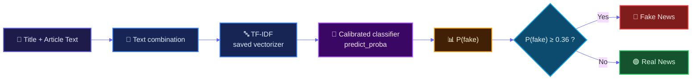

<div align="center">

<h1>🛡️ TruthLens AI</h1>

<a href="https://github.com/AbdelrhmanAkl/AI-Powered-Misinformation-Detection-System">
  
</a>

<br>

An end-to-end NLP system that classifies English news articles as **<span style="color:#22c55e">Real</span>** or **<span style="color:#ef4444">Fake</span>**,<br>
with calibrated probabilities, a frozen production threshold, and a modern Streamlit interface.

<br>

[](https://ai-powered-misinformation-detection-system-kpwevip8yqegvhzvnrk.streamlit.app/)
[](https://www.python.org/)
[](https://scikit-learn.org/)
[](#-production-design)

[](#-production-design)
[](#-dataset)
[](#-limitations)
[](#-responsible-use)

<br>

**[🚀 Live Demo](https://ai-powered-misinformation-detection-system-kpwevip8yqegvhzvnrk.streamlit.app/)** &nbsp;•&nbsp;
**[📦 Repository](https://github.com/AbdelrhmanAkl/AI-Powered-Misinformation-Detection-System)** &nbsp;•&nbsp;
**[⚠️ Limitations](#-limitations)** &nbsp;•&nbsp;
**[🤝 Responsible Use](#-responsible-use)**

</div>

<br>

> [!IMPORTANT]
> TruthLens AI is a **machine-learning text classifier, not a fact-checking engine**.
> It recognizes language patterns associated with the labels in its training data.
> It does **not** verify claims or determine objective truth.

---

## 📑 Table of Contents

<details open>
<summary><b>Click to collapse / expand</b></summary>

<br>

1. [Overview](#-overview)
2. [Highlights](#-highlights)
3. [Application](#-application)
4. [How It Works](#-how-it-works)
5. [Production Design](#-production-design)
6. [Dataset](#-dataset)
7. [Evaluation](#-evaluation)
8. [Getting Started](#-getting-started)
9. [Batch Analysis](#-batch-analysis)
10. [Project Structure](#-project-structure)
11. [Tech Stack](#-tech-stack)
12. [Limitations](#-limitations)
13. [Responsible Use](#-responsible-use)
14. [Roadmap](#-roadmap)
15. [Author](#-author)

</details>

---

## 🔭 Overview

TruthLens AI takes a **news headline** and an **article body**, runs them through a saved production pipeline, and returns:

- 🟢🔴 a **verdict**: Real News or Fake News
- 📊 **probabilities** for both classes
- 🎯 the **decision threshold** applied to the fake-news score

The model is trained offline and shipped as **one frozen artifact**. The app performs inference only; nothing is retrained or re-fitted when users submit articles.

<br>

| Property | Value |
| :--- | :--- |
| 🧩 **Task** | Binary text classification (English news) |
| ✅ **Input features** | `title` + `text` |
| 🚫 **Excluded features** | `subject`, `date` |
| 🔤 **Vectorizer** | `TfidfVectorizer` |
| 🧠 **Classifier** | `CalibratedClassifierCV` (probability-calibrated) |
| ⚖️ **Decision rule** | Fake if `P(fake) ≥ 0.36` |
| 🏷️ **Labels** | `0` = Real News &nbsp;·&nbsp; `1` = Fake News |

---

## ✨ Highlights

| | Feature | Description |
| :---: | :--- | :--- |
| 📈 | **Calibrated probabilities** | Every verdict comes with real and fake scores, not just a hard label. |
| 🧊 | **Frozen inference** | Only `vectorizer.transform()` is used at runtime. No `fit` or `fit_transform`. |
| 🎚️ | **Stored threshold** | The production threshold (`0.36`) lives inside the model package and is reused consistently. |
| 📦 | **Single artifact** | Model, vectorizer, threshold, feature policy, label mapping and metadata ship together. |
| 🗂️ | **Batch mode** | Upload a CSV and download predictions for every row. |
| 🧪 | **Honest evaluation** | Diagnostics are labeled as diagnostics, not as held-out generalization. |
| 🎨 | **Modern interface** | Dark glass design, one-click examples, confidence ring and a threshold-aware score meter. |

---

## 🖥️ Application

The Streamlit app is organized into three tabs.

<table>
  <tr>
    <td width="33%" valign="top">
      <h3>🔍 Analyze</h3>
      Paste a headline and article body, or load a built-in real or fake example. You get a verdict, a confidence ring, the probability breakdown, and a score meter showing where the article sits relative to the threshold.
    </td>
    <td width="33%" valign="top">
      <h3>🗂️ Batch</h3>
      Upload a CSV with <code>title</code> and/or <code>text</code> columns, run inference on every row, filter the results, and download a predictions file.
    </td>
    <td width="33%" valign="top">
      <h3>🧠 Model</h3>
      Inspect the pipeline, saved configuration, feature policy and package metadata.
    </td>
  </tr>
</table>

---

## ⚙️ How It Works



| Step | Stage | What happens |
| :---: | :--- | :--- |
| **1** | 🔗 Combine | Headline and body are merged into one document. |
| **2** | 🔤 Vectorize | The saved TF-IDF vectorizer converts text into weighted numeric features. |
| **3** | 🧠 Score | The calibrated classifier outputs probabilities for both classes. |
| **4** | ⚖️ Decide | The saved threshold turns the fake-news probability into the final label. |

---

## 🏭 Production Design

The production model is stored as a single Joblib package:

```text
models/misinformation_model_package.joblib
```

| Key | Contents |
| :--- | :--- |
| `model` | Trained, calibrated classifier |
| `vectorizer` | Fitted TF-IDF vectorizer |
| `threshold` | Frozen decision threshold (`0.36`) |
| `config` | Training configuration |
| `seed` | Random seed |
| `model_name` | Human-readable model name |
| `feature_policy` | Which fields are used for inference |
| `label_mapping` | Class index to label |
| `metadata` | Additional package information |

On load, the app **validates** the package (required keys, `predict_proba` and `transform` support, threshold range, feature policy) and shows a clear error if anything is wrong.

### 🧾 Feature policy

| Feature | Used in production |
| :--- | :---: |
| `title` | ✅ Yes |
| `text` | ✅ Yes |
| `subject` | ❌ No |
| `date` | ❌ No |

---

## 🗃️ Dataset

Two labeled English news datasets:

| File | Class | Articles |
| :--- | :--- | ---: |
| `data/True.csv` | 🟢 Real | 21,417 |
| `data/Fake.csv` | 🔴 Fake | 23,481 |
| **Total** | | **44,898** |

| Column | Description | Used for inference |
| :--- | :--- | :---: |
| `title` | Article headline | ✅ |
| `text` | Article body | ✅ |
| `subject` | Dataset subject category | ❌ |
| `date` | Publication date | ❌ |

---

## 📏 Evaluation

### 🧪 Production Inference Diagnostic

Run on **1,000 samples** (500 real + 500 fake) drawn from `True.csv` and `Fake.csv`.

| Metric | Result |
| :--- | ---: |
| 🎯 Accuracy | **99.90%** |
| 🔬 Precision | **100.00%** |
| 📡 Recall | **99.80%** |
| ⚡ F1 Score | **99.90%** |

**Confusion matrix**

| | Predicted Real | Predicted Fake |
| :--- | ---: | ---: |
| **Actual Real** | 🟢 500 | 0 |
| **Actual Fake** | 1 | 🟢 499 |

> [!WARNING]
> These numbers are a **production inference diagnostic**, **not** an independent held-out test result.
> The samples come from the same source datasets used during development, so they must **not** be read as an estimate of real-world generalization.
> Reliable generalization claims require an independent held-out set, external data, and ideally temporal or cross-source validation.

Re-run the diagnostic on the saved package (no retraining):

```bash
python evaluate_model.py
```

---

## 🚀 Getting Started

**Requirements:** Python 3.11

**1. Clone the repository**

```bash
git clone https://github.com/AbdelrhmanAkl/AI-Powered-Misinformation-Detection-System.git
cd AI-Powered-Misinformation-Detection-System
```

**2. Create and activate a virtual environment**

```bash
python -m venv .venv
```

```bash
# macOS / Linux
source .venv/bin/activate

# Windows (PowerShell)
.\.venv\Scripts\Activate.ps1
```

> [!TIP]
> If PowerShell blocks activation, call the interpreter directly: `.\.venv\Scripts\python.exe`

**3. Install dependencies**

```bash
pip install -r requirements.txt
```

**4. Run the app**

```bash
streamlit run app.py
```

The app opens at `http://localhost:8501`.

**5. Evaluate the saved package (optional)**

```bash
python evaluate_model.py
```

---

## 🗂️ Batch Analysis

Upload a CSV containing at least one of these columns (case-insensitive):

| Column | Required | Description |
| :--- | :---: | :--- |
| `title` | One of the two | Article headline |
| `text` | One of the two | Article body |

The app appends these columns to your data:

| Output column | Meaning |
| :--- | :--- |
| `prediction` | `0` real, `1` fake (empty on error) |
| `label` | `Real News`, `Fake News` or `Inference Error` |
| `real_probability` | Probability of the real class |
| `fake_probability` | Probability of the fake class |
| `confidence` | Probability of the predicted class |

A ready-made template is available inside the **Batch** tab.

---

## 🌳 Project Structure

```text
AI-Powered-Misinformation-Detection-System/
├── app.py                          # Streamlit application (UI + inference)
├── evaluate_model.py               # Evaluates the saved production package
├── requirements.txt
├── README.md
├── .gitignore
│
├── models/
│   └── misinformation_model_package.joblib
│
├── data/
│   ├── True.csv
│   └── Fake.csv
│
└── notebooks/
    └── <training notebook>
```

---

## 🧰 Tech Stack

[](https://www.python.org/)
[](https://pandas.pydata.org/)
[](https://numpy.org/)
[](https://scikit-learn.org/)
[](https://joblib.readthedocs.io/)
[](https://streamlit.io/)
[](https://jupyter.org/)

| Technology | Purpose |
| :--- | :--- |
| **Python** | Core language |
| **Pandas, NumPy** | Data handling and numerics |
| **scikit-learn** | `TfidfVectorizer`, `CalibratedClassifierCV` |
| **Joblib** | Model serialization and packaging |
| **Streamlit** | Interactive web application |
| **Jupyter / Google Colab** | Experimentation and training |

---

## ⚠️ Limitations

<details>
<summary><b>Click to view all limitations</b></summary>

<br>

| Area | Description |
| :--- | :--- |
| **Dataset-specific patterns** | The model learns statistical patterns tied to its training dataset, which may not reflect real-world news broadly. |
| **Dataset artifacts** | It may pick up stylistic or source-specific cues correlated with labels rather than misinformation itself. |
| **Distribution shift** | Topics, publishers and writing styles change over time; performance on future or unseen data may differ. |
| **Errors** | False positives and false negatives are possible for both classes. |
| **No fact verification** | The system does not browse the web, check claims, validate sources, or establish truth. |
| **English only** | Trained and intended for English-language news. |

</details>

---

## 🤝 Responsible Use

This project is intended for **education, ML/NLP research, experimentation and portfolio demonstration**.

> [!CAUTION]
> Predictions are **model outputs**, not statements about factual accuracy. Do **not** use this system as a standalone source for fact verification or high-stakes decisions. Always confirm important information with reliable, authoritative sources.

---

## 🗺️ Roadmap

Ideas for future work (**not implemented today**):

- [ ] Independent external and temporal validation
- [ ] Cross-source robustness and dataset-artifact analysis
- [ ] Probability calibration analysis
- [ ] Model explainability (for example, top contributing terms)
- [ ] Transformer-based model comparison
- [ ] Drift monitoring and continuous evaluation

---

## 👤 Author

<div align="center">

### **Abdelrahman Akl**

**AI Engineer** &nbsp;·&nbsp; Agentic AI &nbsp;•&nbsp; LLMs &nbsp;•&nbsp; RAG &nbsp;•&nbsp; NLP &nbsp;•&nbsp; Computer Vision &nbsp;•&nbsp; Deep Learning

| | |
| :--- | :--- |
| 🎓 **Teaching** | AI Instructor @ eYouth |
| 💼 **Experience** | Agentic AI Intern @ Orange &nbsp;·&nbsp; AI Engineer Intern @ ZAWOLF.AI |
| 🏅 **Education & Certifications** | NTI AI/ML Graduate &nbsp;·&nbsp; Huawei HCIA-AI Certified |

[](https://github.com/AbdelrhmanAkl)
[](https://www.linkedin.com/in/abdelrahmanakl/)

<br>

If you found this project useful, consider giving it a ⭐

</div>
